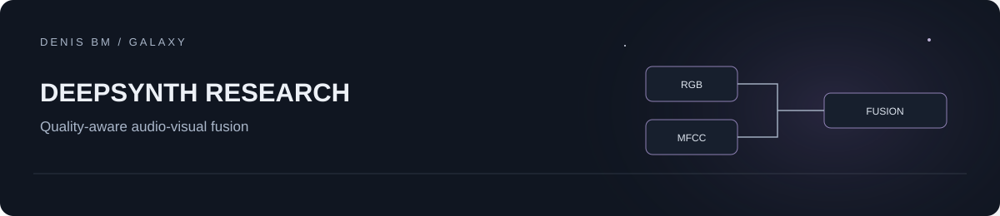

# DeepSynth Research

**Quality-aware audio-visual deepfake detection under video degradation.**

A student research prototype by Denis Bm, a fifth-year student at Don State Technical University. The research question is whether reducing the visual branch's contribution when image quality drops can improve detection over a visual-only control.

## Project context

This is a personal educational project developed with substantial AI assistance. It is included in a student portfolio as a research experiment. The source release documents the approach and its limits; benchmark results under the corrected protocol remain pending.

## Method

```text
Video -> first RGB frame -> pretrained EfficientNet-B4 -> visual MLP -> p_visual
Audio -> first 2 seconds -> 128 mean MFCC coefficients -> audio MLP -> p_audio
Frame -> normalized Laplacian variance -> q -> fixed quality gate
```

The fusion rule is `w = sigmoid(10 * (q - 0.4))`, then `p = w * p_visual + (1 - w) * p_audio`. The MLP branches are trained; the quality gate parameters are fixed. This is a quality heuristic, not a calibrated confidence estimate.

**Status:** source release prepared for rerunning experiments. Corrected-protocol benchmark results and trained weights are not included. No accuracy, novelty or state-of-the-art claim is made.

## Reproduce

Python 3.10+ and FFmpeg on PATH are required. Obtain [FakeAVCeleb](https://github.com/DASH-Lab/FakeAVCeleb) through its authors' access process; dataset files are not redistributed here. Respect the dataset terms and the licenses of the pretrained model and libraries.

```sh
python -m venv .venv
# Activate .venv for your OS, then:
python -m pip install -r requirements.txt
python -m unittest discover -s tests -v
```

Place the authorized dataset so these directories exist:

```text
dataset_source/FakeAVCeleb_v1.2/FakeAVCeleb_v1.2/RealVideo-RealAudio/
dataset_source/FakeAVCeleb_v1.2/FakeAVCeleb_v1.2/FakeVideo-FakeAudio/
```

Then run in order:

```sh
python scripts/01_prepare_dataset.py
python scripts/02_augment.py
python scripts/03_extract_features.py
python scripts/04_train_fusion.py
python scripts/05_evaluate.py
```

The pipeline samples up to 200 clips per class, creates HQ/MQ/LQ encodings, extracts features, trains on HQ and evaluates the same held-out clips at each quality. The encoder downloads its pretrained weights on first use. Training is CPU-compatible and may take time. Feature `.npy` files use pickle; load only your own trusted local outputs.

## Evaluation and limits

- Source-directory IDs are held out together. No train clip appears in evaluation, and quality variants share the same partition. Full separation of all face-swap source/target identities still requires an identity graph or an official split.
- The control is the visual branch of the jointly trained model. A separately trained visual baseline and audio-only baseline remain future work.
- Only `RealVideo-RealAudio` and `FakeVideo-FakeAudio` are sampled. Mixed manipulation classes and cross-dataset testing remain future work.
- One frame, mean MFCCs and Laplacian variance are deliberately simple approximations. There is no temporal modeling, face tracking or universal deepfake verdict.
- Report ROC-AUC after rerunning; include dataset version, split, seed and failures. Do not reuse scores from an earlier protocol.

See [methodology](docs/METHODOLOGY.md) and [release review](docs/RELEASE_REVIEW.md). Protocol tests run without PyTorch or dataset downloads. End-to-end training has not been rerun as part of this packaging pass.

## Code rights

No general reuse license is assigned in this release. Dataset and third-party software licenses are separate. Contact the author before redistribution of this project's own code.
